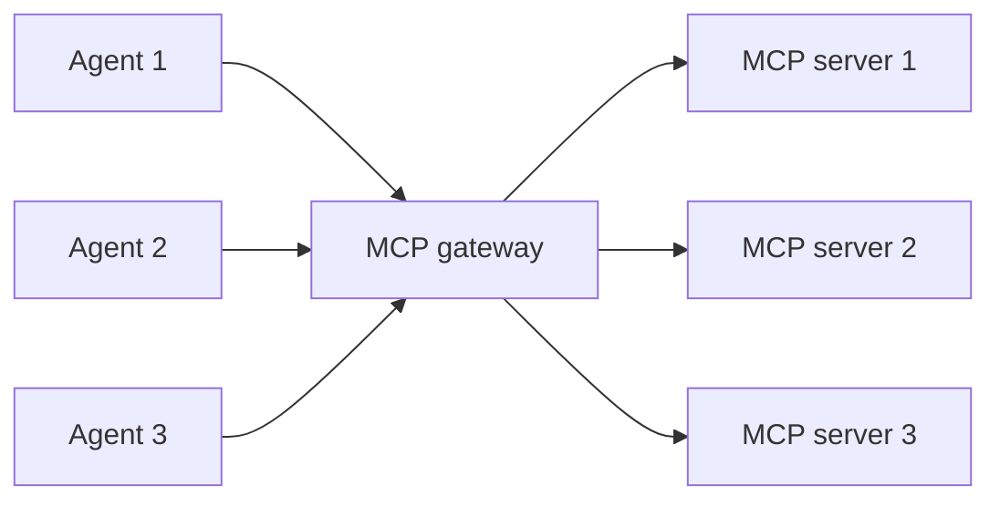
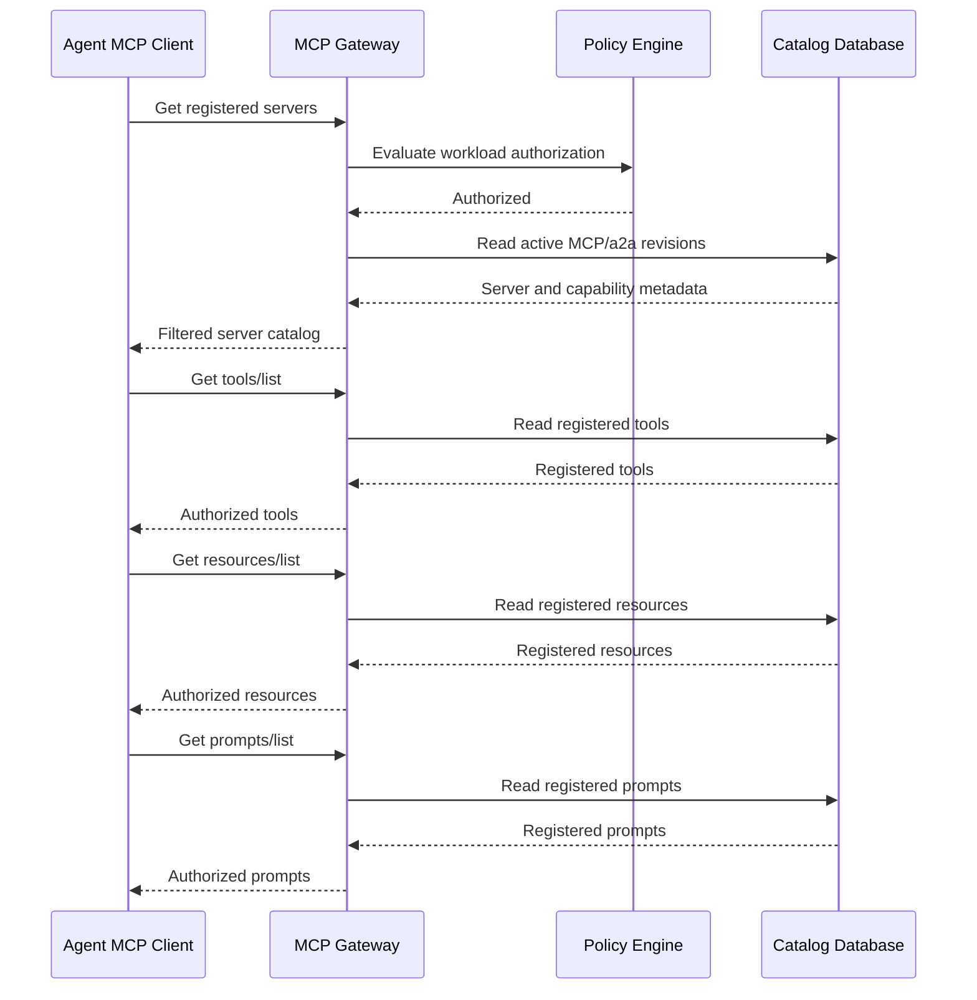

# Architecture

This document describes the high level topology, architecture system design, data flow and components relantionshios.

## Topology Overview

## Architecture design Overview

## Components