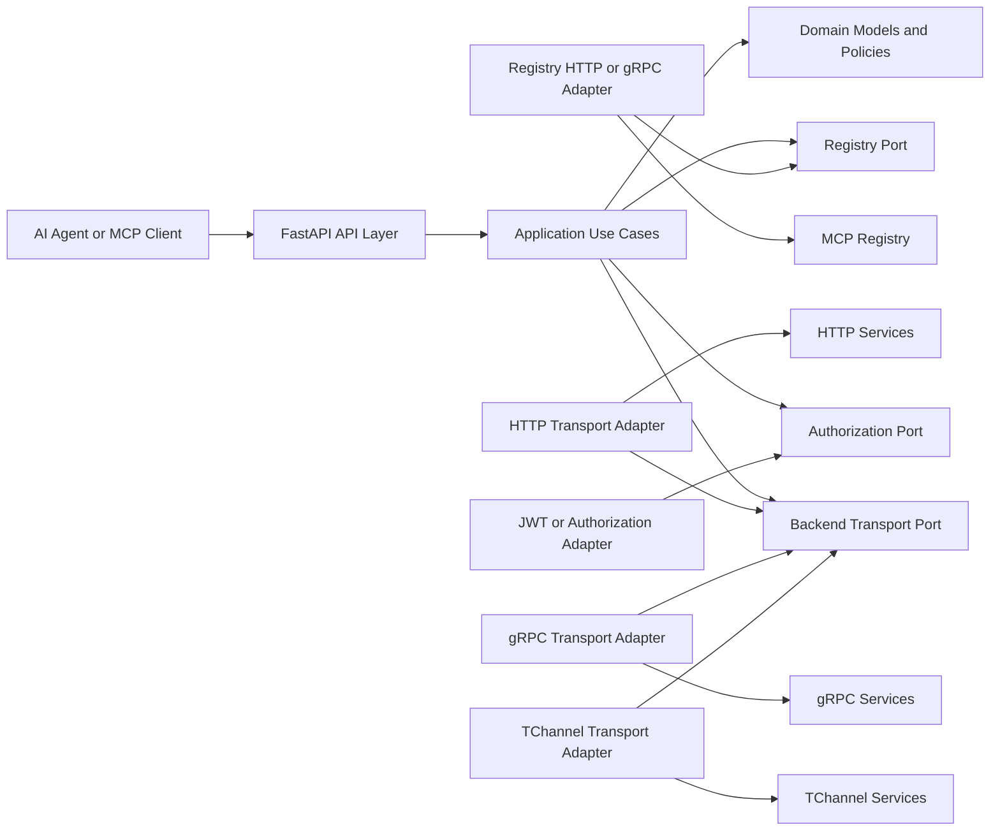

# Project specification


```text
src/
└── mcp_gateway/
    ├── api/
    │   └── http/
    │       ├── router/
    │       │   ├── endpoint.py
    │       ├── middleware/
    │       │   ├── middleware_auth.py
    │       │   └── middleware_metric.py
    │       └── app.py
    │
    ├── application/
    │   ├── ports/
    │   │   ├── registry.py
    │   │   ├── backend_transport.py
    │   │   ├── authorization.py
    │   │   └── invocation_audit.py
    │   └── exceptions.py
    │
    ├── domain/
    │   ├── model/
    │   │   ├── health.py
    │   │   └── service.py
    |   ├── external/
    │   │   ├── model.py
    │   |   └── error_response.py
    |   ├── usecase/
    │   │   ├── register.py
    │   |   └── health.py
    │   └── exceptions.py
    │
    ├── infrastructure/
    │   ├── registry/
    │   │   ├── http_registry_client.py
    │   │   └── cached_registry_client.py
    │   ├── transports/
    │   │   ├── http_transport.py
    │   │   ├── grpc_transport.py
    │   │   ├── tchannel_transport.py
    │   │   └── transport_factory.py
    │   ├── security/
    │   │   ├── token_verifier.py
    │   │   ├── cedar_verifier.py
    │   │   ├───── policy/
    │   │   └──────── policy.cedar
    │   ├── observability/
    │   │   ├── logger.py
    │   │   ├── metric.py
    │   │   └── tracer.py
    │   └── persistence/
    │       └── invocation_audit_repository.py
    │
    ├── config/
    │   └── settings.py
    │
    ├── bootstrap/
    │   └── container.py
    │
    └── main.py
```

Dependency


1. Software Design
- Languagem Python 3.14
- Webserver FASTAPI
- Clean Architecture (controlers, usecase, adapters, etc)
- API endpoints:
    - GET v1/info
    - 

2. Database Schemma


3. Software Standarts
- Use separate Request DTOs, Response DTOs, and Domain Models
- 
